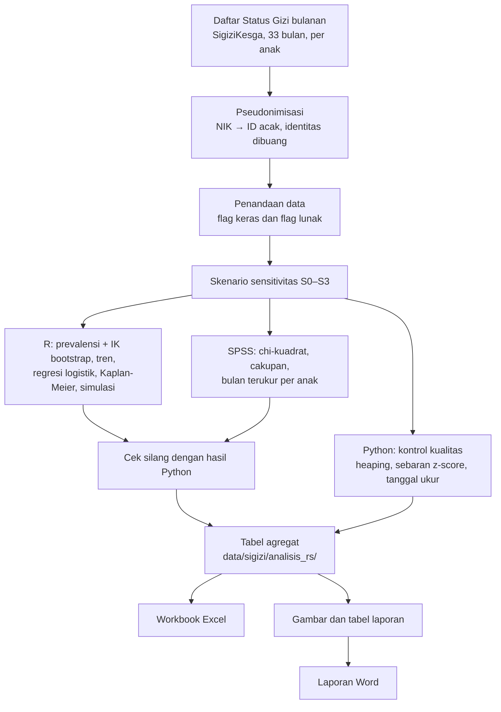

# Mini Riset Stunting, Puskesmas Mumbulsari 2024–2026

Analisis data rutin SigiziKesga (pengukuran antropometri balita) di Puskesmas Mumbulsari: prevalensi dan tren stunting, perbedaan antar desa, kualitas data pengukuran, dan faktor risiko. Kepaniteraan Ilmu Kesehatan Masyarakat, FK Universitas Jember.

Penulis: Thalia Anisya Dewi, Fitranda Kusyanto Taslim.

## Data tidak ada di repo ini

Data per anak memuat identitas (nama, NIK, nomor RM), jadi **tidak** diunggah. Yang ada di repo hanya hasil agregat (tingkat desa, bulan, atau kelompok umur) yang dipakai untuk tabel dan gambar laporan. Skrip yang membaca data per anak tidak bisa dijalankan tanpa data sumber, tetapi tetap bisa dibaca untuk memeriksa caranya.

Berkas yang sengaja di-ignore ada di `.gitignore` (data sumber, data bersih per anak, rekap per posyandu, laporan `.docx`/`.pdf`, arsip).

## Metodologi singkat

Analisis data sekunder dari catatan rutin SigiziKesga (modul e-PPGBM): 108.322 pengukuran dari 6.312 balita (0–59 bulan) di tujuh desa wilayah kerja Puskesmas Mumbulsari, Januari 2024–September 2026. Seluruh pengukuran dianalisis (tanpa sampling), kecuali baris dengan flag keras.

- **Outcome:** stunting (TB/U < −2 SD), wasting (BB/TB < −2 SD), underweight (BB/U < −2 SD), mengikuti Permenkes 2/2020 dan standar WHO 2006.
- **Faktor risiko:** BBLR (< 2.500 g), PBLR (< 48 cm), jenis kelamin, kelompok umur.
- **Kualitas data:** penumpukan digit tinggi badan (heaping), sebaran z-score di sekitar −2 SD, sebaran tanggal ukur, perubahan tinggi antarbulan, cakupan, dan kontinuitas pengukuran.
- **Pembersihan:** NIK diganti ID acak (HMAC-SHA256 dengan garam lokal), identitas dibuang. Data bermasalah ditandai, tidak dihapus. Flag keras (z-score penanda, nilai nol atau mustahil, NIK ganda dalam satu bulan, umur di luar 0–<60 bulan) mengeluarkan baris dari semua analisis. Flag lunak dipakai untuk analisis sensitivitas.
- **Skenario sensitivitas:** S0 semua baris tanpa flag keras (105.600 pengukuran); S1 = S0 tanpa Lampeji, Mumbulsari, dan Lengkong pada Jan–Sep 2026; S2 = S0 hanya pada desa-tahun dengan heaping rendah (< 70%); S3 = S0 tanpa desa-bulan anomali.
- **Prevalensi:** gabungan anak-bulan; IK 95% dengan bootstrap klaster per anak (500 ulangan). Perbandingan antar desa, jenis kelamin, dan umur memakai uji chi-kuadrat pada satu pengukuran acak per anak per tahun.
- **Tren:** uji Mann-Kendall dan kemiringan Sen, serta regresi segmented dengan titik patah Januari 2026 (galat baku Newey-West).
- **Faktor risiko:** regresi logistik pada anak-bulan, disesuaikan jenis kelamin, umur, dan efek tetap desa × tahun, dengan galat baku robust klaster per anak.
- **Longitudinal:** Kaplan-Meier dan log-rank untuk waktu hingga stunting pertama, dengan analisis sensitivitas (kejadian terkonfirmasi, delayed entry, stratifikasi desa). Simulasi pembulatan tinggi memakai parameter LMS WHO 2006.
- **Alat:** Python 3.12 (pembersihan, penandaan skenario, workbook, gambar), R 4.6 (prevalensi, tren, regresi, survival, simulasi), SPSS 27 (chi-kuadrat, cakupan, bulan terukur per anak).

### Alur analisis



Rincian skrip untuk tiap kotak ada di [`skrip/README.md`](skrip/README.md); aturan pembersihan lengkap di [`data/sigizi/RENCANA_ANALISIS.md`](data/sigizi/RENCANA_ANALISIS.md).

## Struktur

| Folder | Isi |
|---|---|
| `skrip/` | Skrip Python, R, dan SPSS: pembersihan data, z-score WHO 2006, analisis, pembuatan gambar dan laporan. Penjelasan tiap skrip dan alurnya ada di [`skrip/README.md`](skrip/README.md). |
| `data/sigizi/analisis/` | Hasil analisis versi Python (`tabel/*.csv`, termasuk `who_lhfa_lms.csv`). |
| `data/sigizi/analisis_r/` | Hasil analisis R (tren Mann-Kendall dan Sen, regresi segmen, Kaplan-Meier, bootstrap klaster, simulasi pembulatan). |
| `data/sigizi/analisis_rs/`, `analisis_spss/` | Hasil gabungan R dan SPSS, serta pembanding dengan Python. |
| `data/sigizi/laporan/gambar/` | Gambar yang dipakai di laporan. |
| `data/sigizi/rekap_*/` | Rekap agregat dari situs SigiziKesga (per desa, jenis kelamin, insiden stunting). |
| `referensi/` | Daftar pustaka (`.bib`, ekspor Zotero) dan gaya sitasi (`.csl`). |
| `TODO.md`, `data/sigizi/RENCANA_ANALISIS.md` | Catatan kerja dan rencana analisis. |

## Menjalankan ulang

Dengan data sumber lokal (tidak ada di repo):

```bash
sh jalankan_analisis_sigizi.sh
```

Hanya gambar laporan, dari hasil agregat di repo:

```bash
python skrip/buat_gambar_laporan.py [folder_keluaran]
```

Kebutuhan: Python 3.12 (`pip install -r requirements.txt`), R 4.6 (paket `anthro` untuk z-score WHO), dan SPSS 27 bila ingin mengulang analisis SPSS.

## Catatan kehati-hatian

- Beberapa baris `desa_bulan.csv` memiliki jumlah anak kecil (n < 20; terendah 2). Hati-hati bila dipublikasikan.
- Sebelum repo dibuat publik: periksa ulang sel kecil, dan pastikan izin dari puskesmas dan fakultas.

## Lisensi

Kode: MIT (`LICENSE`). Hasil agregat dan gambar: sebaiknya CC BY 4.0 bila nanti dipublikasikan.
