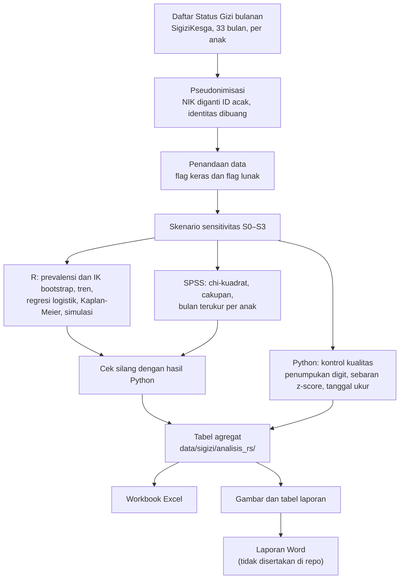

# Mini Riset Stunting Puskesmas Mumbulsari, 2024–2026

Repositori ini berisi kode dan hasil agregat dari analisis data rutin pengukuran balita di wilayah kerja Puskesmas Mumbulsari, Kabupaten Jember. Data berasal dari aplikasi SigiziKesga (modul e-PPGBM) dan mencakup Januari 2024 sampai September 2026. Analisis ini dikerjakan sebagai mini riset pada Kepaniteraan Ilmu Kesehatan Masyarakat, Fakultas Kedokteran Universitas Jember, oleh Thalia Anisya Dewi dan Fitranda Kusyanto Taslim.

Pertanyaan awalnya sederhana: berapa prevalensi stunting, wasting, dan underweight di tujuh desa wilayah Puskesmas, bagaimana trennya, dan faktor apa yang berhubungan dengannya (berat dan panjang lahir rendah, jenis kelamin, umur). Di tengah pengerjaan muncul pertanyaan kedua yang akhirnya menjadi temuan utama: seberapa jauh data rutin ini bisa dipercaya. Tinggi badan banyak yang dibulatkan, sebagian desa hanya mengisi satu tanggal ukur untuk seluruh bulan, dan angka di beberapa desa berubah drastis dari satu bulan ke bulan berikutnya. Karena itu sebagian besar skrip di sini mengerjakan pemeriksaan kualitas data, dan semua hasil prevalensi dihitung ulang pada beberapa skenario pembersihan.

## Ringkasan temuan

Prevalensi stunting gabungan seluruh Puskesmas adalah 6,5% pada 2024 (IK 95% 6,0–7,1), 13,1% pada 2025 (12,2–13,9), dan 7,0% pada 2026 (6,4–7,6). Angka ini jauh di bawah prevalensi nasional dari SSGI 2024 (19,8%). Kedua sumber memakai metode berbeda sehingga tidak bisa dibandingkan langsung, tetapi pola datanya memberi alasan untuk menduga bahwa prevalensi yang tercatat lebih rendah dari keadaan sebenarnya. Tiga hal mendukung dugaan itu:

- Digit desimal tinggi badan menumpuk pada .0 dan .5, di beberapa desa sampai 98%, padahal pengukuran yang teliti seharusnya menghasilkan sekitar 20%.
- Jumlah anak dengan z-score TB/U tepat di atas −2 SD jauh lebih banyak daripada yang tepat di bawahnya. Simulasi pembulatan saja tidak cukup untuk menghasilkan penumpukan sebesar itu.
- Pada Januari 2026, tiga desa (Lampeji, Mumbulsari, Lengkong) berubah pola secara tiba-tiba: cakupan melonjak mendekati 100%, stunting turun ke 1,4–2,4%, dan banyak anak tercatat lebih pendek daripada bulan sebelumnya.

Ini baru indikasi dari pola data. Dugaan bahwa tinggi badan disesuaikan agar anak tidak tergolong stunting belum diuji dengan pengukuran ulang, dan petugas baru membenarkan soal pembulatan serta pengisian satu tanggal per bulan.

Untuk faktor risiko, pada model regresi logistik yang disesuaikan jenis kelamin, umur, dan desa × tahun (skenario S3), anak dengan berat lahir rendah (BBLR) memiliki odds stunting sekitar dua kali lipat (OR 2,11; IK 95% 1,64–2,71), anak dengan panjang lahir rendah (PBLR) sekitar 1,5 kali (OR 1,47; 1,15–1,88), dan anak perempuan memiliki odds yang lebih rendah daripada anak laki-laki (OR 0,68; 0,60–0,78). Arah dan besar hubungan ini hampir sama pada skenario S0, S1, dan S3 (S2 tidak dimodelkan). Semuanya adalah asosiasi dari data observasional, bukan hubungan sebab-akibat.

## Data tidak ada di repo ini

Data per anak memuat nama, NIK, dan nomor rekam medis, sehingga tidak diunggah. Yang ada di repo hanya hasil agregat pada tingkat desa, bulan, atau kelompok umur. Skrip yang membaca data per anak tidak bisa dijalankan tanpa data sumber, tetapi kodenya tetap bisa dibaca untuk memeriksa cara kerjanya. Berkas yang dikecualikan tercantum di `.gitignore`: data sumber, data bersih per anak, rekap per posyandu, dan laporan Word atau PDF.

## Metodologi singkat

Ini adalah analisis data sekunder dari catatan rutin. Populasinya 108.322 pengukuran dari 6.312 balita (0–59 bulan) di tujuh desa. Tidak ada sampling: semua pengukuran dianalisis, kecuali baris yang tidak masuk akal secara biologis atau administratif (lihat "flag keras" di bawah), sehingga tersisa 105.600 pengukuran.

**Outcome dan faktor risiko.** Stunting didefinisikan sebagai TB/U di bawah −2 SD, wasting sebagai BB/TB di bawah −2 SD, dan underweight sebagai BB/U di bawah −2 SD, sesuai Permenkes 2/2020 yang mengacu pada standar pertumbuhan WHO 2006. Faktor risiko yang dianalisis adalah BBLR (berat lahir di bawah 2.500 g), PBLR (panjang lahir di bawah 48 cm), jenis kelamin, dan kelompok umur.

**Pembersihan data.** NIK diganti dengan ID acak (HMAC-SHA256 dengan garam yang hanya disimpan lokal), lalu nama, alamat, dan tanggal lahir dibuang. Data yang bermasalah ditandai, tidak dihapus. Ada dua jenis tanda. Flag keras (z-score penanda, tinggi atau berat nol, nilai mustahil, NIK ganda dalam satu bulan, umur di luar 0–59 bulan) mengeluarkan baris dari semua analisis. Flag lunak (desa-bulan dengan banyak z-score outlier, desa-tahun dengan penumpukan digit tinggi, satu tanggal ukur untuk banyak anak) tidak membuang baris, tetapi dipakai untuk membentuk skenario sensitivitas.

**Skenario sensitivitas.** Karena tidak bisa dipastikan di mana saja masalah kualitas data berada, semua hasil dihitung pada empat himpunan data. S0 adalah semua baris tanpa flag keras. S1 membuang tiga desa yang pola datanya berubah pada Januari–September 2026 (Lampeji, Mumbulsari, Lengkong). S2 hanya memakai desa-tahun dengan penumpukan digit rendah (kurang dari 70%). S3 membuang desa-bulan yang anomali. Jika sebuah temuan hanya muncul di satu skenario, temuan itu tidak dianggap kokoh.

**Metode statistik.**
- Prevalensi dihitung dari seluruh pengukuran anak-bulan. Karena anak yang sama diukur berulang, interval kepercayaan memakai bootstrap klaster per anak (500 ulangan), bukan rumus binomial biasa.
- Perbandingan antar desa, jenis kelamin, dan umur memakai uji chi-kuadrat pada satu pengukuran acak per anak per tahun, supaya sampel yang diuji saling bebas.
- Tren bulanan diuji dengan Mann-Kendall dan kemiringan Sen, ditambah regresi segmented dengan titik patah Januari 2026.
- Faktor risiko dianalisis dengan regresi logistik pada anak-bulan, disesuaikan jenis kelamin, umur, dan efek tetap desa × tahun, dengan galat baku robust klaster per anak. Efek tetap desa × tahun membuat anak hanya dibandingkan dengan anak lain di desa dan tahun yang sama, sehingga artefak pencatatan yang seragam dalam satu desa-tahun tidak ikut terbaca sebagai faktor risiko.
- Waktu hingga stunting pertama dianalisis dengan Kaplan-Meier dan uji log-rank, termasuk analisis sensitivitas dengan kejadian yang harus terkonfirmasi dua kali berturut-turut.
- Untuk menguji apakah pembulatan tinggi badan saja bisa menimbulkan penumpukan z-score di atas −2 SD, dilakukan simulasi dengan parameter LMS WHO 2006.

**Alat.** Python 3.12 untuk pembersihan, penandaan skenario, workbook, dan gambar; R 4.6 untuk prevalensi, tren, regresi, survival, dan simulasi; SPSS 27 untuk chi-kuadrat, cakupan, dan jumlah bulan terukur per anak. Analisis yang sama juga dikerjakan di Python dan dibandingkan dengan hasil R atau SPSS untuk memastikan tidak ada kesalahan implementasi. Selisihnya hanya pada batas interval bootstrap, karena generator angka acaknya berbeda.

### Alur analisis



Penjelasan tiap skrip ada di [`skrip/README.md`](skrip/README.md). Aturan pembersihan yang lengkap ada di [`data/sigizi/RENCANA_ANALISIS.md`](data/sigizi/RENCANA_ANALISIS.md).

## Isi folder

| Folder | Isi |
|---|---|
| `skrip/` | Semua kode: pembersihan data, audit kualitas, analisis di Python, R, dan SPSS, serta pembuatan workbook, gambar, dan laporan. Lihat [`skrip/README.md`](skrip/README.md). |
| `data/sigizi/analisis/` | Hasil analisis versi Python: tabel CSV, workbook Excel akhir, dan tabel LMS WHO (`who_lhfa_lms.csv`). |
| `data/sigizi/analisis_r/` | Hasil analisis versi R: tren, regresi segmen, Kaplan-Meier, bootstrap klaster, simulasi pembulatan. |
| `data/sigizi/analisis_rs/`, `analisis_spss/` | Hasil gabungan R dan SPSS yang dipakai untuk laporan, serta perbandingannya dengan hasil Python. |
| `data/sigizi/laporan/` | Gambar dan tabel yang dipakai di laporan, beserta catatan cara membangunnya. |
| `data/sigizi/rekap_*/` | Rekap agregat yang diunduh dari situs SigiziKesga (per desa, per jenis kelamin, insiden stunting, sasaran). |
| `referensi/` | Daftar pustaka (`.bib` dan ekspor Zotero) dan gaya sitasi (`.csl`). |
| `data/sigizi/RENCANA_ANALISIS.md` | Rencana analisis: aturan pembersihan, skenario, dan daftar analisis. |

## Menjalankan ulang

Dengan data sumber di komputer lokal (tidak ada di repo), analisis R dan SPSS beserta workbook dan bahan laporan bisa dijalankan ulang dengan:

```bash
sh jalankan_analisis_sigizi.sh
```

Skrip ini mengasumsikan `anak_bersih.csv` sudah dibuat oleh `skrip/bersihkan_data_anak.py` dan mengacu pada lokasi instalasi R dan SPSS di komputer penulis, jadi jalurnya perlu disesuaikan.

Tanpa data sumber, yang bisa dijalankan hanyalah pembuatan gambar laporan dari hasil agregat yang ada di repo:

```bash
python skrip/buat_gambar_laporan.py [folder_keluaran]
```

Kebutuhan: Python 3.12 (`pip install -r requirements.txt`), R 4.6 dengan paket `anthro` untuk z-score WHO, dan SPSS 27 bila ingin mengulang analisis SPSS.

## Hal yang perlu diperhatikan

Beberapa baris di `desa_bulan.csv` dan tabel per desa memiliki jumlah anak yang kecil (n kurang dari 20, terendah 2). Persentase dari angka sekecil itu tidak stabil dan tidak boleh dibaca sebagai prevalensi desa tersebut. Prevalensi absolut dalam repo ini juga sebaiknya tidak dipakai sebagai angka resmi, karena masalah kualitas data yang diuraikan di atas.

## Lisensi

Kode (skrip dan sintaks) memakai lisensi MIT, lihat [`LICENSE`](LICENSE). Hasil agregat, tabel, dan gambar memakai CC BY 4.0, lihat [`LICENSE-HASIL.txt`](LICENSE-HASIL.txt). Keduanya boleh dipakai dan dimodifikasi dengan menyebut sumber; cara sitasi ada di [`CITATION.cff`](CITATION.cff).
