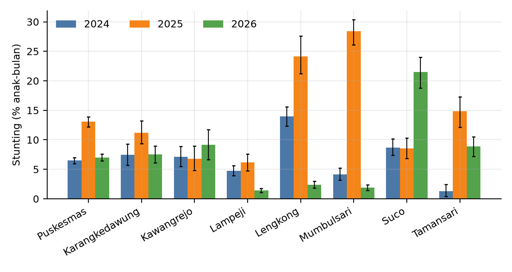
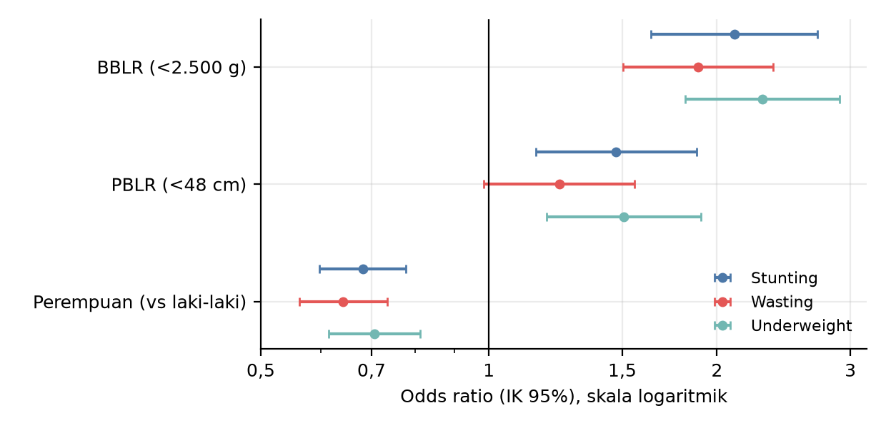
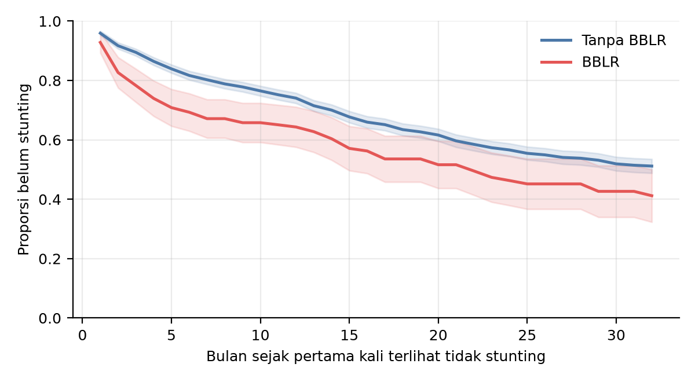

# Mini Riset Stunting, Puskesmas Mumbulsari 2024–2026

Analisis data rutin SigiziKesga (pengukuran antropometri balita) di Puskesmas Mumbulsari: prevalensi dan tren stunting, perbedaan antar desa, kualitas data pengukuran, dan faktor risiko. Kepaniteraan Ilmu Kesehatan Masyarakat, FK Universitas Jember.

Penulis: Thalia Anisya Dewi, Fitranda Kusyanto Taslim.

## Data tidak ada di repo ini

Data per anak memuat identitas (nama, NIK, nomor RM), jadi **tidak** diunggah. Yang ada di repo hanya hasil agregat (tingkat desa, bulan, atau kelompok umur) yang dipakai untuk tabel dan gambar laporan. Skrip yang membaca data per anak tidak bisa dijalankan tanpa data sumber, tetapi tetap bisa dibaca untuk memeriksa caranya.

Berkas yang sengaja di-ignore ada di `.gitignore` (data sumber, data bersih per anak, rekap per posyandu, laporan `.docx`/`.pdf`, arsip).

## Cuplikan hasil

Seluruh gambar dari hasil agregat (bukan data per anak).


*Prevalensi stunting (% anak-bulan, IK 95%) per desa dan tahun.*


*Odds ratio BBLR, PBLR, dan jenis kelamin terhadap stunting, wasting, dan underweight.*


*Waktu hingga stunting pada anak dengan dan tanpa BBLR.*

## Struktur

| Folder | Isi |
|---|---|
| `skrip/` | Skrip Python, R, dan SPSS: pembersihan data, z-score WHO 2006, analisis, pembuatan gambar. `buat_gambar_laporan.py` membuat Gambar 3, 5, dan 9 laporan dari hasil agregat. |
| `data/sigizi/analisis/` | Hasil analisis versi Python (`tabel/*.csv`, termasuk `who_lhfa_lms.csv`). |
| `data/sigizi/analisis_r/` | Hasil analisis R (tren Mann-Kendall dan Sen, regresi segmen, Kaplan-Meier, bootstrap klaster, simulasi pembulatan). |
| `data/sigizi/analisis_rs/`, `analisis_spss/` | Hasil gabungan R dan SPSS, serta pembanding dengan Python. |
| `data/sigizi/laporan/gambar/` | Gambar yang dipakai di laporan. |
| `data/sigizi/rekap_*/` | Rekap agregat dari situs SigiziKesga (per desa, jenis kelamin, insiden stunting). |
| `referensi/` | Daftar pustaka (`.bib`, ekspor Zotero) dan gaya sitasi (`.csl`). |
| `TODO.md`, `data/sigizi/RENCANA_ANALISIS.md` | Catatan kerja dan rencana analisis. |

## Menjalankan ulang

Dengan data sumber lokal (tidak ada di repo):

```bash
sh jalankan_analisis_sigizi.sh
```

Hanya gambar laporan, dari hasil agregat di repo:

```bash
python skrip/buat_gambar_laporan.py [folder_keluaran]
```

Kebutuhan: Python 3.12 (`pip install -r requirements.txt`), R 4.6 (paket `anthro` untuk z-score WHO), dan SPSS 27 bila ingin mengulang analisis SPSS.

## Catatan kehati-hatian

- Beberapa baris `desa_bulan.csv` memiliki jumlah anak kecil (n < 20; terendah 2). Hati-hati bila dipublikasikan.
- Sebelum repo dibuat publik: periksa ulang sel kecil, dan pastikan izin dari puskesmas dan fakultas.

## Lisensi

Kode: MIT (`LICENSE`). Hasil agregat dan gambar: sebaiknya CC BY 4.0 bila nanti dipublikasikan.
